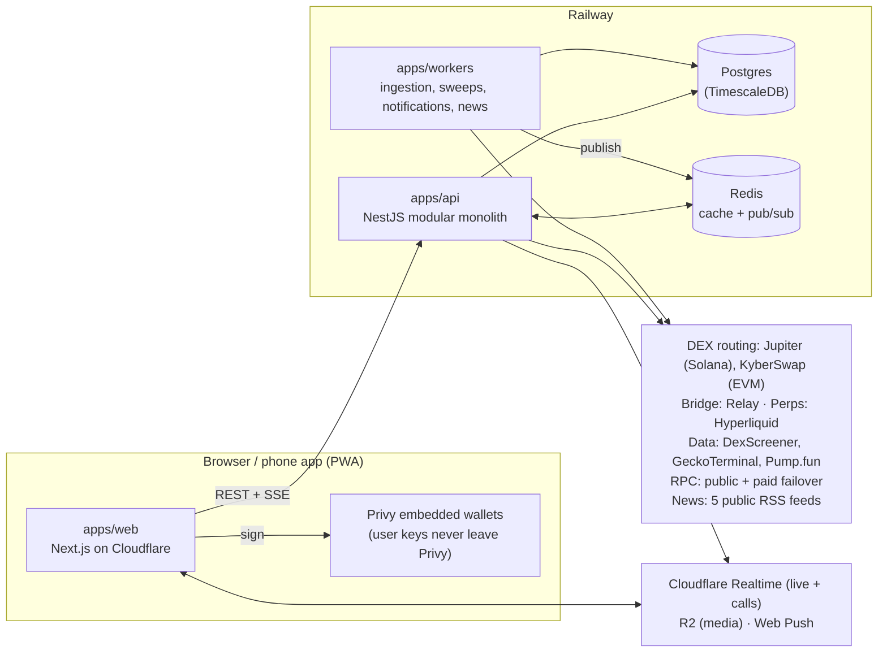

# Kamby

**Find. Trade. Repeat.** Kamby is a social crypto trading app. You find coins, trade them with
one tap from a USDC balance, and see what other traders do and say, live.

Live at **[kambesh.com](https://kambesh.com)**. It works on the web and installs as an app on
phones (PWA), in 14 languages.

---

## What's in the app

| Area | Route | What it does |
|---|---|---|
| **Home** | `/home` | Your balance, top traders this week, your holdings, whales trading now, the latest news, and the live coin lists. |
| **Trade** | `/terminal`, `/market/[chain]/[address]`, `/solana?mint=` | The trading screen: chart (1s → 1D), holders, live trades, top traders, token chat, a news line and the buy/sell panel. ⚡ quick buy sits on every coin row. |
| **Feed** | `/feed` | Posts from traders: text, photos, videos, Trade Cards and PnL cards. Headlines are mixed in. Tapping a coin opens its chart and buy panel without leaving the feed. |
| **News** | `/news` | Crypto headlines from CoinDesk, Cointelegraph, Decrypt, Blockworks and Bitcoin Magazine, streamed live and tagged with verified coins. |
| **Live** | `/live`, `/live/[id]` | Live streams (voice, screen, camera) with chat, tips, polls and a coin panel. Every Kamby trade by someone in the room shows up in chat, and viewers can copy it with ⚡. Sorted by viewers or traded volume, filtered by topic. |
| **Messages** | `/messages` | Direct messages and groups, voice/video/screen calls, and communities. |
| **Leaders** | `/leaderboard` | PnL leaderboard by chain, plus Squads, no-stake Duels and Track (whales and people you follow). |
| **Perps** | `/perps` | Perpetuals on Hyperliquid (web, geo-restricted). |
| **LaunchPad** | `/launch` | Launch a coin on Pump.fun (Solana), Clanker (Base) or Four.meme (BNB). |
| **Profile** | `/account`, `/trader/[address]` | Your profile, P&L calendar, trade history, referrals and notification settings. Every trader has a public profile. |

**Chains:** Solana, Base, BNB Chain and Robinhood Chain.
**Money:** users hold USDC only. Network gas is covered by Kamby's gas tank, so trades are
gas-free for the user. Kamby's fee appears in the trade summary as a dollar amount before you
confirm.

---

## How it fits together



- **apps/web** renders the app. Server components fetch the first paint from the API, and
  the browser then keeps it live over Server-Sent Events.
- **apps/api** owns every read and write: market data, trading quotes and transactions,
  social, live, DMs, news and notifications. It never stores or uses a user's private key.
- **apps/workers** runs on timers. It ingests prices and swaps, discovers pools, confirms
  trades on-chain, sweeps PnL, sends notifications and push messages, and polls the news
  feeds. Results go into Postgres, and events are published on Redis.
- **Redis pub/sub → SSE:** a worker or the API publishes an event on a channel (new trade,
  chat line, headline…). The API keeps one subscriber per process and fans each event out
  to every connected browser over SSE. There are no WebSockets between browser and API.

### A trade, end to end

1. The trade panel asks the API for a **quote**: Jupiter for Solana, KyberSwap for EVM. Kamby's
   fee is built into the same swap, so the user signs once.
2. The user **signs** in the browser with their Privy wallet. On Solana, Kamby can sponsor
   network gas as fee payer, but it can't move the user's funds.
3. The transaction is broadcast, and a worker **confirms** it on-chain. Only a confirmed
   trade is recorded, charged a fee, and added to PnL.
4. The confirmed trade fans out: the coin's live trades and token chat, a live room if the
   trader is in one, the leaderboard and notifications.

### News, end to end

Every 2.5 minutes the workers poll the five feeds in parallel, with a 5 s timeout per feed.
They then:

- clean the HTML, drop tracking and keep only links to the publisher's own site;
- de-duplicate by a hash of the normalised title;
- tag coins **only** from a verified list (Kamby's own markets, which must still hold real
  liquidity), so a headline never points to a copycat token.

The latest 100 headlines stay in Redis and the full history is kept in Postgres. New
headlines stream to the app. An alert toast appears only for coins you hold, watch, or have
open.

---

## Repository

```text
apps/
  web/        Next.js 14 (App Router) on Cloudflare Workers via OpenNext. Tailwind, next-intl
              (14 locales), Privy, lightweight-charts.
  api/        NestJS. Modules: market, market-feeds, trading, solana, chain, social,
              identity, notifications, pulse (chats), dm, calls, live, feed, news, duels,
              squads, launchpad, bridge, transfers, referrals, media, health.
  workers/    Plain Node process: market + Solana ingestion, pool discovery, Pump.fun /
              PumpPortal ingestion, trade sweeps, PnL ledger, notification extras, news.
packages/
  domain/          Shared types, Zod schemas and pure logic (scores, fees, PnL, news matching).
  db/              Prisma schema + migrations, shared PrismaClient.
  chain-adapters/  EVM reads, pool readers and RPC usage accounting.
  ui/              Shared React primitives and cn().
  config/          Shared tsconfig / ESLint / Tailwind presets.
docs/              Design notes per area (trading, market data, social, notifications,
                   wallet security, deployment, testing…).
```

## Running it locally

Prerequisites: Node 20 (see `.node-version`), pnpm 9 (`corepack enable`) and Docker.

```bash
pnpm install
cp apps/web/.env.example apps/web/.env.local
cp apps/api/.env.example apps/api/.env
cp apps/workers/.env.example apps/workers/.env

docker compose up -d          # Postgres (TimescaleDB) + Redis
pnpm db:migrate:deploy
pnpm dev                      # web :3000, api :4000, workers
```

Every app validates its environment at boot with Zod, so a missing variable fails
immediately with its name. **Never commit `.env` files or keys.** Production secrets live
only in the hosting provider's settings.

```bash
pnpm test        # unit + component tests (Vitest / Jest)
pnpm lint
pnpm typecheck
pnpm build
```

CI (`.github/workflows/ci.yml`) runs lint, typecheck, migrations against real Postgres/Redis,
unit tests, API and worker e2e tests, and the build on every push to `main`.

## Deployment

- **Web:** `cd apps/web && pnpm cf:deploy` (OpenNext → Cloudflare Workers).
- **API + workers:** Railway, deployed automatically on push to `main`. The workers run one
  instance per chain, and the main instance also runs notifications and news.
- **Database migrations** run against production with `prisma migrate deploy` inside the
  API service.

See [`docs/DEPLOYMENT.md`](./docs/DEPLOYMENT.md) and [`docs/LAUNCH_RUNBOOK.md`](./docs/LAUNCH_RUNBOOK.md).

## Principles

- **Non-custodial.** Kamby never holds a user's private key and never signs a trade for them.
  See [`docs/WALLET_SECURITY.md`](./docs/WALLET_SECURITY.md).
- **Real data or nothing.** Prices, liquidity, PnL and stats come from chain or market data.
  A value Kamby can't verify shows as unknown, never as a guess.
- **Verified coins only where it matters.** News tags, cashtags in posts and curated lists
  link to contract addresses Kamby has verified, never to a lookalike ticker.
- **One failing widget never takes down the page.** Every widget sits in its own error
  boundary with a Retry, and the app recovers by itself when a stream drops.
- **Money is shown in dollars.** Fees appear as their dollar amount before you confirm.

## Docs

[Trading](./docs/TRADING.md) · [Market data](./docs/MARKET_DATA.md) ·
[Social](./docs/SOCIAL.md) · [Notifications](./docs/NOTIFICATIONS.md) ·
[Wallet security](./docs/WALLET_SECURITY.md) · [Chain adapters](./docs/CHAIN_ADAPTERS.md) ·
[Source of truth](./docs/SOURCE_OF_TRUTH.md) · [Testing](./docs/TESTING.md) ·
[Deployment](./docs/DEPLOYMENT.md)
